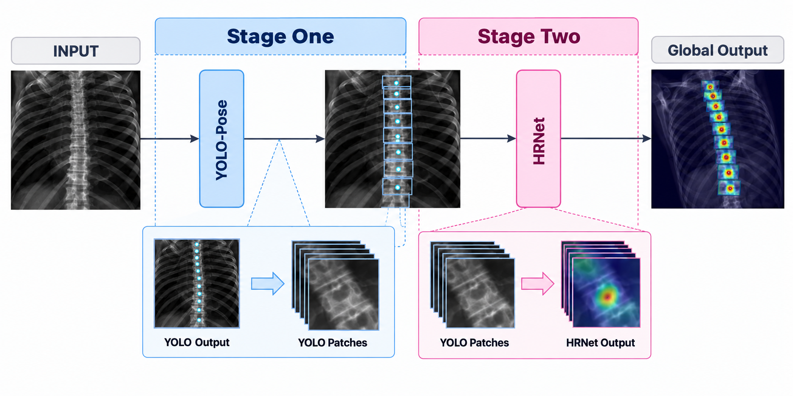

# SpineLocus

[](https://zenodo.org/records/23325290)

**Research software only; not validated for clinical use.**

Research code for locating T1–T11 thoracic landmarks in digitally reconstructed radiographs (DRRs) with YOLO-Pose and optional HRNet refinement. It includes dataset checks, subject-level splitting, training, full-image evaluation, coordinate ensembles, and diagnostic audits. Windows and Linux with NVIDIA GPUs are supported; CPU-only tests cover the data and evaluation logic.

## Research status and dataset integrity

SpineLocus implements subject-disjoint training, validation and test partitions. Model training for the reported experiments starts from generic pretrained weights rather than checkpoints trained on overlapping study subjects. Earlier overlapping-subject evaluations are **not** used as evidence of generalization.

An aggregate, filename-based audit of the local DRR collection counted **4,553 JPEG images across 80 subject identifiers**. The curated experiment subset comprises **3,362 images from 74 subjects**, partitioned into **2,022 training images (44 subjects), 750 validation images (15 subjects) and 590 held-out test images (15 subjects)**. Every selected image basename was found in the source DRR collection; there were **zero duplicate image basenames and zero subjects shared between partitions**. Selection targeted a consistent T1–T11 task, with additional anatomical levels not uniformly represented across subjects. This audit does **not** establish pixel-level identity, original CT provenance, redistribution rights or independent test-set performance. See [data provenance and audit boundaries](docs/DATA_PROVENANCE.md).

On a repeatedly inspected validation set of **750 images from 15 subjects**, the fixed YOLO960 + two HRNet feature1 models with HRNet flip TTA and an identity guard gave **82.31% mean subject PCK@5**, **6.424 px mean error**, and **36.452 px P95** across the 11 landmarks. An exploratory two-view YOLO flip variant gave 82.86%, 6.126 px, and 34.201 px respectively. Its paired subject bootstrap interval for the PCK@5 gain was **−0.29 to +1.23 percentage points**, and the gain in mean error was **−0.045 to +0.553 px**. The intervals include zero. The no-flip method remains the primary validation baseline; no outcome from a final test is claimed here. Neither model weights nor the image dataset are distributed.

## Pipeline overview



*Pipeline concept and reference diagram by Luca Serioli; AI-assisted illustrative rendering. Depicted anatomy, coordinates and heatmaps are schematic, not experimental predictions or validation evidence. Optional ensembles, test-time augmentation and identity safeguards are omitted for clarity. See [figure provenance](docs/figures/PROVENANCE.md).*

## Install and check

Use a separate Python 3.12 environment. On Windows with a compatible NVIDIA driver:

```powershell
powershell -ExecutionPolicy Bypass -File scripts/setup_windows.ps1
.\.venv\Scripts\python.exe -m unittest discover -s tests -v
```

On Linux, install the compatible PyTorch/torchvision pair for your platform, then:

```bash
python -m pip install -e '.[train,dev]'
python -m unittest discover -s tests -v
python -m ruff check src tests scripts
```

`python -m spinelocus --help` lists commands. A dataset must be supplied locally; `data/`, `runs/`, `reports/`, weights, and private evidence are ignored by Git.

## Working with a local dataset

Create a manifest from images and labels, then make a new subject-grouped dataset if the original split overlaps:

```bash
python -m spinelocus manifest --data data/original --out data/original-manifest.csv --hash-images
python -m spinelocus split --data data/original --manifest data/original-manifest.csv --out data/subjectsplit --seed 42
```

Check the produced split and train **all** models on that split. The config examples in `configs/` separate reference settings from exploratory settings. Historical dataset checkpoints must not initialize a subject-disjoint experiment.

For full-image validation with local checkpoints:

```bash
python -m spinelocus evaluate --data data/subjectsplit --manifest data/subjectsplit/manifest.csv --split val --yolo runs/yolo960/weights/best.pt --hrnet runs/hrnet-seed42/best.pt --hrnet-extra runs/hrnet-seed43/best.pt --imgsz 960 --tta --identity-guard nearest-yolo --out runs/validation-baseline --device 0
```

The exploratory variant adds `--yolo-flip-tta` and writes to a **new** output directory. It averages the original and mirrored YOLO coordinates before forming HRNet crops. `compare-yolo-flip` validates paired results from saved validation runs. Evaluate the final test only after the analysis protocol has been fixed; the CLI requires `--final-test` for that step.

Results depend on the dataset, source manifest, checkpoint hashes, and configured protocol. The reported validation population was used during method development and cannot provide an independent generalization estimate.

## Software authorship, distribution and citation

**SpineLocus is an independently implemented Python research-software project authored and maintained by Luca Serioli.** Software authorship is recorded in [CITATION.cff](CITATION.cff) and [pyproject.toml](pyproject.toml). The repository provides implementation, configurations, synthetic tests and evaluation tools; it does **not** distribute CT volumes, DRRs, annotations, participant records, trained checkpoints or private research files.

The source code is released under [AGPL-3.0-only](LICENSE). Third-party software and methods retain their own rights and attribution; see [third-party notices](THIRD_PARTY_NOTICES.md). Access to an imaging dataset, or possession of derived images, does not itself grant permission to redistribute it. The illustrative figure has a [separate provenance statement](docs/figures/PROVENANCE.md). The [v0.1.7 source release is archived on Zenodo](https://zenodo.org/records/23325290) under DOI [`10.5281/zenodo.23325290`](https://doi.org/10.5281/zenodo.23325290). This DOI identifies the specific v0.1.7 archive; future versions may receive separate DOIs.
